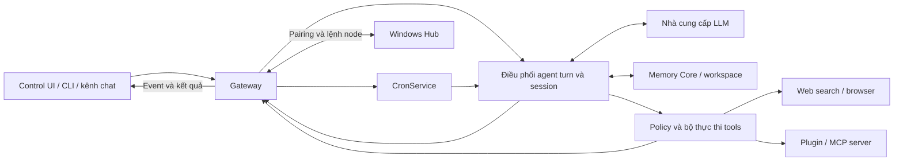

# 01 — Kiến trúc OpenClaw

**Mốc khảo sát** v2026.11.3, release SHA `847611dcaa3bf0e2783335f961dd1fd0580e4d9f` do upstream công bố. Chọn tag phát hành để các dẫn chứng có cùng mốc. Khảo sát tĩnh qua GitHub, mã nguồn thô và tài liệu chính thức. Shell thiếu Git, WSL chưa cài và DNS GitHub thất bại. Connector GitHub trả 403. Chưa có clone cục bộ, kiểm kê toàn bộ cây nguồn, build hay kiểm thử runtime. Docs trực tuyến có thể đi trước tag. [Release và SHA](https://github.com/openclaw/openclaw/releases/tag/v2026.11.3#release-verification)

| Thành phần | Vai trò và bằng chứng |
|---|---|
| CLI và monorepo | TypeScript, Node `>=24.16.0 <25 || >=26.1.0`, pnpm 12.15.0. Manifest có Express, ws, TypeBox, OpenAI SDK, Playwright Core, pg và sqlite-vec tùy chọn. Release khai báo SQLite và PostgreSQL cho các kho dữ liệu được hỗ trợ. [package.json](https://github.com/openclaw/openclaw/blob/v2026.11.3/package.json) |
| Gateway | Điểm vào cho client điều khiển và node. WebSocket có handshake, danh tính, role/scope, request/response và event. Chat và agent có handler riêng. [Protocol tại tag](https://github.com/openclaw/openclaw/blob/v2026.11.3/docs/gateway/protocol.md) · [chat.ts](https://github.com/openclaw/openclaw/blob/v2026.11.3/src/gateway/server-methods/chat.ts) · [agent.ts](https://github.com/openclaw/openclaw/blob/v2026.11.3/src/gateway/server-methods/agent.ts) |
| Agent runtime | Gateway tiếp nhận turn, ràng buộc session và chuyển sang dịch vụ điều phối turn. Agent tạo ngữ cảnh, gọi model đã cấu hình, xử lý tool call dưới policy rồi trả kết quả. [agent-turn-service.ts](https://github.com/openclaw/openclaw/blob/v2026.11.3/src/gateway/agent-turn/agent-turn-service.ts) · [Agent](https://docs.openclaw.ai/concepts/agent) |
| Tools, plugins và skills | Tools có schema cho model. Plugin TypeScript đăng ký tool hoặc tích hợp runtime qua SDK. Skill bổ sung hướng dẫn cho agent và có thể yêu cầu binary bên ngoài. MCP kết nối tool ngoài tiến trình, vẫn chịu tool policy. [Tools](https://docs.openclaw.ai/tools) · [MCP tại tag](https://github.com/openclaw/openclaw/blob/v2026.11.3/docs/tools/mcp.md) · [Ví dụ skill gog](https://github.com/openclaw/openclaw/blob/v2026.11.3/skills/gog/SKILL.md) |
| Memory và session | Session giữ lịch sử hội thoại. Memory Core cung cấp lớp truy hồi và củng cố ghi nhớ từ workspace. Dreaming có chu kỳ và nhật ký riêng. Dữ liệu lịch sử, bộ nhớ bền và chỉ mục có vòng đời khác nhau. [Memory Core](https://github.com/openclaw/openclaw/blob/v2026.11.3/extensions/memory-core/index.ts) · [Dreaming tại tag](https://github.com/openclaw/openclaw/blob/v2026.11.3/docs/concepts/dreaming.md) |
| Scheduler | Gateway có các phương thức quản lý job. CronService điều phối lịch, chạy và truy vấn job qua các operation có khóa. [cron RPC](https://github.com/openclaw/openclaw/blob/v2026.11.3/src/gateway/server-methods/cron.ts) · [CronService](https://github.com/openclaw/openclaw/blob/v2026.11.3/src/cron/service.ts) |
| UI và Windows | Control UI dùng Lit/Vite. Windows Hub là companion WinUI phát hành riêng, có tray, chat, chẩn đoán, pairing và năng lực Windows có điều khiển. WSL2 là môi trường Linux tương thích cho Gateway; thao tác desktop diễn ra trong phiên Windows qua node. Hub cũng có chế độ MCP loopback. [UI manifest](https://github.com/openclaw/openclaw/blob/v2026.11.3/ui/package.json) · [Windows và WSL2](https://docs.openclaw.ai/platforms/windows) · [Windows Hub](https://github.com/openclaw/openclaw-windows-node) |

Một turn nhận yêu cầu đã xác thực và định tuyến vào session. Model suy luận từ ngữ cảnh và schema của các tool được cấp. Runtime kiểm tra policy trước khi gọi tool và đưa kết quả trở lại model. API key, khả năng tool calling và mức reasoning phụ thuộc model/provider đã chọn. Với Đệ Tốt, dùng model để hiểu ý định và dùng quy tắc xác định để kiểm tra quyền, tham số và tác động. [OpenRouter](https://docs.openclaw.ai/providers/openrouter) · [Tools](https://docs.openclaw.ai/tools)
