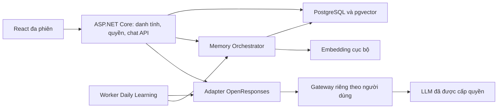

# 07 — Kiến trúc Advanced Personal AI Core

**Trạng thái** Đề xuất để Product Owner và System Architect duyệt. Phạm vi hiện tại là khảo sát tĩnh và thiết kế. Mốc OpenClaw `2026.11.3`, release SHA `847611dcaa3bf0e2783335f961dd1fd0580e4d9f`. Đã đối chiếu package đã cài trong Lab, tài liệu đi kèm bản này và mã nguồn đã khảo sát. [Release](https://github.com/openclaw/openclaw/releases/tag/v2026.11.3)

## Tương thích và phạm vi tái sử dụng

| Thành phần | Bằng chứng và quyết định |
|---|---|
| Gateway, agent và tool calling | Lab dùng OpenResponses loopback, client function tools và continuation. Tận dụng runtime cùng hợp đồng này, kiểm thử lại hợp đồng với DeepSeek thật bằng dữ liệu giả sau khi duyệt. Bearer HTTP có quyền operator rộng. Chỉ backend giữ bearer theo từng Gateway. [OpenResponses tại tag](https://github.com/openclaw/openclaw/blob/v2026.11.3/docs/gateway/openresponses-http-api.md) |
| Memory Core | Đã thấy plugin manifest và entrypoint trong package Lab. Plugin có retrieval và lưu ký ức theo workspace. Chạy đối chứng với corpus giả trong Gateway riêng để đo recall tiếng Việt và chi phí. Dùng cơ chế truy hồi và tổ chức ký ức của upstream làm đường chuẩn. [Memory Core tại tag](https://github.com/openclaw/openclaw/blob/v2026.11.3/extensions/memory-core/index.ts) |
| Dreaming | Tài liệu cùng bản ghi mặc định bật khi đủ điều kiện, dùng cron và các pha light, REM, deep. Pha deep ghi `MEMORY.md` và dùng bằng chứng cùng bộ lọc nguồn. Áp dụng cách tách thu thập, phản tư và xét duyệt trong Daily Learning. Chạy Dreaming đối chứng trong workspace giả riêng, tắt slot memory và Dreaming trên Gateway phục vụ Đệ Tốt để dữ liệu chỉ có một đường ghi và thu hồi. [Dreaming tại tag](https://github.com/openclaw/openclaw/blob/v2026.11.3/docs/concepts/dreaming.md) |
| Memory Orchestrator, Daily Learning, React | Phát triển mới ở Đệ Tốt. Workspace và index của Gateway chưa đáp ứng hợp đồng consent theo nguồn/mục đích, CRUD, export, xóa xuyên projection và cách ly hai người dùng của sản phẩm. ASP.NET Core sở hữu quyền, lifecycle memory và lịch học. |
| Mem0 | Hoãn tích hợp. Sau đối chứng Memory Core/Dreaming và Orchestrator, chỉ mở spike nếu có khoảng cách đo được. Đánh giá self-host, đường egress, license artifact, xóa, export, cô lập tenant và provenance bằng cùng bộ test. [Mem0](https://github.com/mem0ai/mem0) |

## Thiết kế đề xuất

- **Phiên chat.** React dùng API cùng origin và cookie phiên xác thực. ASP.NET Core sinh session ID, lưu transcript theo người dùng và kiểm tra quyền sở hữu cho mọi thao tác. Mỗi lượt chat có idempotency ID do ứng dụng quản lý. Backend gửi ngữ cảnh có giới hạn tới Gateway qua OpenResponses. Dùng `previous_response_id` nội bộ trong một chuỗi tool call, gắn với user, turn và Gateway cụ thể. Giữa các lượt người dùng, dựng context từ transcript đã được phép và memory đang hiệu lực. Xác minh chế độ incognito/retention và hợp đồng replay trước khi dùng dữ liệu thật. [OpenResponses tại tag](https://github.com/openclaw/openclaw/blob/v2026.11.3/docs/gateway/openresponses-http-api.md)
- **Ranh giới Gateway.** Mỗi người dùng có Gateway, state, workspace và token riêng, chạy dưới tài khoản OS hoặc container cô lập. Backend ánh xạ danh tính đã xác thực tới tuyến cố định phía máy chủ. Lab một người dùng giữ một instance. Bài kiểm thử hai người dùng dùng hai instance hoặc hai tiến trình giả lập có định danh tách biệt, nghiệm thu cách ly runtime bắt buộc dùng hai Gateway thật. [Trust model tại tag](https://github.com/openclaw/openclaw/blob/v2026.11.3/docs/gateway/security/trust-model.md)
- **Retrieval.** Backend gọi Memory Orchestrator trước turn nếu user bật recall. LLM có thể gọi `memory.search` để thu hẹp hoặc mở rộng truy hồi trong cùng ngân sách. Ưu tiên consent và relevance trước freshness. Chèn các đoạn có nguồn dưới dạng dữ liệu với ID trích dẫn, dùng giới hạn tại tài liệu 08. Ý định và lựa chọn tool do model quyết định từ schema.
- **Daily Learning.** ASP.NET Core worker dùng lịch theo múi giờ người dùng, lease trong PostgreSQL và checkpoint theo nguồn. Chỉ đọc phiên chat hoặc nguồn mà người dùng đã opt-in riêng cho mục đích học. Job phân loại bằng chứng và tạo đề xuất chờ duyệt. Dùng job key gồm user, ngày địa phương và nguồn để chống chạy trùng khi restart/DST. Kiểm tra consent lúc xếp lịch, trước mỗi lần đọc/gửi và trước commit. Bật mặc định là tắt. Tiến trình học gọi agent profile không có tool và chỉ gửi đoạn được phép nếu người dùng cho phép xử lý qua provider.
- **React đa phiên.** Danh sách phiên, chat và lịch sử theo trang. Màn hình memory hiển thị loại, phạm vi, nguồn, trạng thái và thao tác xem, sửa, xóa, xuất, tắt. Thao tác ghi đi qua endpoint có xác thực và CSRF, cập nhật theo phiên bản để phát hiện chỉnh sửa đồng thời. Nội dung LLM hiển thị text/Markdown đã lọc.

## Dependency và điều kiện chọn bản

| Dependency | Phạm vi đã đối chiếu và điều kiện nghiệm thu |
|---|---|
| OpenClaw và Node | Ghim mốc đã khảo sát, kiểm tra dependency advisory ở tài liệu 06 trên artifact triển khai. Giữ Control UI tắt. Nghiệm thu actual provider và tool/continuation trên build được duyệt. |
| ASP.NET Core .NET 10, React | Lab đã build .NET 10. React là UI mới. Chốt phiên bản, lockfile, audit transitive và kiểm tra cookie/CSRF/XSS trước triển khai. [React](https://react.dev/learn) |
| PostgreSQL, pgvector, Npgsql và pgvector-dotnet | Kho ứng dụng riêng vì cần transaction, provenance, RLS, xóa và backup nhất quán. Dùng SQL cosine và thử exact search trước. Đã đối chiếu giao diện Npgsql và tích hợp vector .NET. Ghim phiên bản PostgreSQL được hỗ trợ, extension và driver sau kiểm tra tương thích, license, SBOM và restore. [Npgsql](https://www.npgsql.org/doc/basic-usage.html) · [pgvector-dotnet](https://github.com/pgvector/pgvector-dotnet) · [pgvector](https://github.com/pgvector/pgvector) |
| Embedding cục bộ | Ứng viên BAAI BGE-M3 dense đa ngôn ngữ, 1024 chiều. Chốt revision, tokenizer, runtime CPU, hash và cách pooling trên corpus tiếng Việt giả. Embedding và độ tương đồng đều được tính nội bộ. [Model card và license](https://huggingface.co/BAAI/bge-m3) |

Rủi ro cần duyệt gồm chi phí mỗi Gateway, khả năng xóa transcript phụ của Gateway, vector nhạy cảm khi DB đang mở, giới hạn hợp đồng DeepSeek và advisory dependency của release ghim. Thiết kế và kết quả đã khảo sát chưa xác nhận các tiêu chí nghiệm thu runtime mới.
