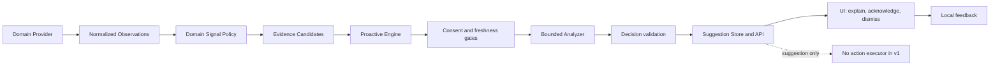

# Proactive Intelligence Engine — kiến trúc đề xuất

**Trạng thái (17/11/2026):** kiến trúc nền đã được triển khai cho Weather; đây tiếp tục là tài liệu hợp đồng và ranh giới module. Baseline migration hiện tại là `712493b`, sau contract/golden tests `468ffef`. API Weather cũ được giữ tương thích. Chưa có domain proactive thứ hai.

Weather có thêm luồng cảnh báo NCHMF chính thức qua Google Public Alerts trong commit `3c2b25b`. Đây là endpoint cảnh báo bổ sung theo địa điểm chọn tay, có consent riêng; nó trả cảnh báo nguồn trực tiếp, không tạo Weather suggestion và không gọi Analyzer/DeepSeek. Không xem luồng này là provider/domain thứ hai của Proactive Engine.

## Mục tiêu và nguyên tắc

Engine cung cấp một luồng chung để tiếp nhận quan sát đã được cấp quyền, gắn bằng chứng, đánh giá tính mới/độ tin cậy/mức liên quan, quyết định có nên đề xuất, chống lặp và lưu vòng đời đề xuất. Engine không biết cách gọi API thời tiết, đọc Gmail, kiểm tra lỗ hổng hay đo dung lượng ổ đĩa.

- Provider chỉ thu thập và chuẩn hóa quan sát. Provider không quyết định hành động hoặc gửi nội dung thô sang model.
- Quyền được kiểm tra tại Backend cho từng giai đoạn: thu thập ngoài, xử lý/lưu local, phân tích ngoài và phản hồi. Không suy quyền từ OAuth hay quyền của giai đoạn khác.
- Engine im lặng nếu consent thiếu, evidence sai cấu trúc/hết hạn, analyzer lỗi hoặc không chọn candidate hợp lệ.
- AI chỉ được chọn candidate và mã quyết định trong danh sách cho phép. Engine dựng lại nội dung hiển thị từ evidence, không tin title/reason/số liệu/confidence tự do do model trả về.
- Bản đầu chỉ tạo và quản lý gợi ý. Không có action executor. Khi cần thao tác bên ngoài, phải thiết kế quyền riêng, xác nhận người dùng và kiểm tra lại quyền ngay trước khi hành động.
- Không đọc Chat, Memory, Gmail, Calendar, Drive, Device Status hoặc thêm provider ngầm. Mỗi nguồn mới cần consent contract và kiểm thử riêng.

## Ranh giới module



**Domain Provider** chuyển giao thức nguồn thành dữ liệu đã chuẩn hóa, có provenance và thời gian. Nó không được biết UI, trạng thái gợi ý hay lịch feedback.

**Domain Signal Policy** chứa các ngưỡng/ý nghĩa chỉ domain biết. Ví dụ, quy tắc ba giờ mưa lớn là Weather policy, không phải điều kiện chung trong Engine. Policy tạo candidate có evidence; nó không tạo câu khuyến nghị tùy ý.

**Proactive Engine** điều phối provider/policy/analyzer, consent lease, freshness, dedupe, giới hạn số lượng, lưu trạng thái và thu hồi dữ liệu phái sinh.

**Analyzer** là một cổng được cấu hình tường minh; có thể là luật local hoặc model. Model nhận projection tối thiểu của candidate và chỉ trả ID cùng code trong allowlist. Nếu analyzer bắt buộc của provider không có, lỗi hoặc thiếu consent thì Engine im lặng. Không có fallback local ngầm. Muốn dùng luật local phải đăng ký một analyzer riêng với semantics, consent và test của nó.

**Suggestion API/UI** hiển thị bằng chứng, lý do, thời điểm, trạng thái và phản hồi. Không gọi connector để hành động.

## DTO và interface đề xuất

Các đoạn dưới đây là hình dạng hợp đồng để review, không phải code cần chép nguyên trạng. DTO cần version hóa và kiểm tra kích thước/giới hạn trước khi lưu hoặc gửi.

```csharp
public interface IProactiveProvider
{
    string ProviderId { get; }
    ProactiveConsentPlan ConsentPlan { get; }
    Task<ObservationBatch> CollectAsync(ProviderRequest request, CancellationToken cancellationToken);
}

public sealed record ProactiveConsentPlan(
    IReadOnlyList<ConsentRequirement> CollectionRequirements,
    IReadOnlyList<ConsentRequirement> LocalProcessingRequirements,
    IReadOnlyList<ConsentRequirement> PersistenceRequirements,
    IReadOnlyList<ConsentRequirement> FeedbackRequirements);

public interface IProactiveDomainPolicy
{
    string DomainId { get; }
    IReadOnlyList<EvidenceCandidate> CreateCandidates(ObservationBatch observations);
}

public interface IProactiveAnalyzer
{
    string AnalyzerId { get; }
    IReadOnlyList<ConsentRequirement> RequirementsFor(AnalysisProjection projection);
    Task<IReadOnlyList<AnalyzerDecision>> EvaluateAsync(
        IReadOnlyList<AnalysisCandidate> candidates, CancellationToken cancellationToken);
}

public interface IProactiveEngine
{
    Task<ProactiveSnapshot> RefreshAsync(string ownerId, string providerId,
        CancellationToken cancellationToken);
    Task<bool> RecordFeedbackAsync(string ownerId, Guid suggestionId,
        FeedbackKind feedback, CancellationToken cancellationToken);
}
```

Suggested DTOs:

```csharp
public sealed record ProviderRequest(string OwnerId, Guid RunId, DateTimeOffset RequestedAt);

public sealed record ObservationBatch(
    string ProviderId, int SchemaVersion, DateTimeOffset RetrievedAt,
    DateTimeOffset? SourceUpdatedAt, DateTimeOffset ExpiresAt,
    IReadOnlyList<ProactiveEvidence> Evidence);

public sealed record ProactiveEvidence(
    string EvidenceId, string SourceName, Uri SourceUri,
    DateTimeOffset? ObservedAt, DateTimeOffset RetrievedAt, DateTimeOffset ExpiresAt,
    string ContentHash, string LicenseId, Uri? LicenseUri,
    string Attribution, int SchemaVersion, JsonElement Facts);

public sealed record EvidenceCandidate(
    string CandidateId, string ProviderId, string DomainId, string SignalType,
    IReadOnlyList<string> EvidenceIds, IReadOnlyList<string> ReasonCodes,
    double EventProbability, string ProbabilityMeaning, DateTimeOffset ExpiresAt,
    JsonElement SafeAnalysisFacts);

public sealed record AnalyzerDecision(string CandidateId, string DecisionCode);

public sealed record ProactiveSuggestion(
    Guid Id, string ProviderId, string DomainId, string SignalType,
    string Title, string Explanation, string SuggestedActionCode,
    IReadOnlyList<string> EvidenceIds, double? EventProbability,
    double? EvidenceConfidence, double? Relevance,
    DateTimeOffset CreatedAt, DateTimeOffset ExpiresAt,
    SuggestionState State, int SchemaVersion);

public sealed record FeedbackRecord(
    Guid SuggestionId, FeedbackKind Kind, DateTimeOffset RecordedAt);
```

`Facts` and `SafeAnalysisFacts` must use a versioned, provider-specific schema with an explicit outbound projection. Do not pass an entire `ObservationBatch` or generic serialized object to DeepSeek. Keep city/coordinates and other identifying fields out of analyzer payload unless a separate purpose-specific grant explicitly permits them. Unknown schema versions and unknown decision codes fail closed.

`OwnerId` is an internal routing/storage key only. Provider code may use it to load that owner's explicitly configured source settings, but it must never be copied into an external request or shown to an analyzer. The Engine evaluates the relevant `ProactiveConsentPlan` stage before invoking a provider operation, local projection/persistence, feedback storage, or analyzer; the provider never receives the consent service itself.

`EvidenceConfidence`, `Relevance` and `EventProbability` are distinct:

- `EventProbability` is a source/domain measurement, such as 94% rain probability. It is not confidence that the evidence is correct or the advice is useful.
- `EvidenceConfidence` is produced by validated source quality, freshness, completeness and any calibrated domain method. The LLM must not author this number.
- `Relevance` expresses fit to allowed user context/preferences. The first version should use explicitly enabled preferences or deterministic domain rules; it must not silently read Memory or Chat.

If a score has no defensible calculation, represent it as `null` plus an explanation/reason code instead of inventing a numeric value.

## Consent, leases and revocation

The current Weather route obtains one `RunConsent` set containing local storage, external service and DeepSeek permission before collection. That behavior is conservative and must remain for the existing `/api/weather*` routes during migration. The shared design can model stages separately without silently relaxing those legacy routes:

1. **Collection:** provider declares exact `(source, purpose, destination)` requirements for the external request. Missing grant means no provider call.
2. **Local projection/storage:** local processing and persistence require the matching `local_only` grants. No cache read/write or derived suggestion survives a denied local permission.
3. **External analysis:** analyzer declares its own destination requirements, e.g. exact DeepSeek grant. The Engine sends only a bounded projection after checking that lease.
4. **Suggestion commit:** verify the relevant lease is still current before storing or returning results. A revoked or changed grant discards the in-flight result.
5. **Feedback:** separate local `skill_learning` consent; no feedback is sent to DeepSeek by default.
6. **Action:** absent in v1. The UI may let a user acknowledge or dismiss a suggestion; neither status is an instruction to execute an external action. A future action must have its own consent purpose and explicit user approval, with a second backend check immediately before execution.

The provider and analyzer must not be able to bypass the Engine's gate. The Engine owns the orchestration lease and cancellation token; provider code receives only the authorized request context. On revoke, cancel in-flight work, prevent retries/new jobs, clear provider cache and suggestions covered by the revoked grant, remove their feedback/derived rows according to the retention policy, and record metadata without sensitive contents. External data already sent cannot be withdrawn by local deletion.

`ConsentPolicy.TryBegin`/`ExecuteIfCurrent` already provide fail-closed checks and cancel a lease when its owner policy changes. Current leases are **owner-revision-wide**: changing any consent tuple invalidates all jobs for that owner, including an unrelated provider. This is safe but over-broad and may cause unnecessary retries as providers grow. Keep it as the compatibility behavior initially; a later fine-grained lease revision model needs its own race/restart/revoke audit and must never weaken checks.

## Freshness, evidence, dedupe and lifecycle

- Every observation and candidate has source/retrieval/expiry times. Reject malformed, future-dated beyond tolerance, incomplete, out-of-range and expired facts. Provider failure yields status/error metadata and no new candidate.
- Existing suggestion may remain visible only while its evidence and suggestion are within explicit TTL, with a stale label when appropriate. Once expired, hide it; never reuse it as a fresh result after offline retry.
- Stable candidate identity includes provider/domain, signal type, normalized evidence identity and time window. The persisted suggestion ID is owner-scoped; repeated worker runs cannot create duplicates for the same evidence window.
- Suggested states for v1: `proposed`, `shown`, `dismissed`, `accepted`, `expired`, `withdrawn`. “Accepted” means user acknowledged a suggestion, not that a side effect ran. Any external action state belongs to a future, separately consented action workflow.
- Suggestion stores reference evidence IDs and immutable source facts/hash; explanation is assembled from facts/reason codes. Keep encrypted owner-scoped storage and retention/deletion policy. Do not store raw provider responses without a defined need and consent.
- Feedback is local and opt-in. `dismissed` suppresses a matching candidate; `interested` may be counted locally. No model training, cross-domain profile, or AutoSkill handoff is implied.
- Worker scheduling belongs to Engine; provider cadence/backoff are configuration/capabilities, not custom polling loops duplicated in every provider. Use per-owner/provider single-flight and bounded concurrency.

## Mapping Weather hiện tại

| Hiện tại trong `WeatherIntelligence` | Module đích | Tương thích cần giữ |
|---|---|---|
| `GeocodeAsync`, `FetchForecastAsync`, response limits, range/time validation, timezone parsing | `OpenMeteoProvider` | Gửi đúng city người dùng nhập; tọa độ chỉ dùng gọi weather source, không vào analyzer projection |
| `WeatherLocation`, `ForecastData`, `ForecastHour` | Provider DTO → versioned observation/evidence | Bảo toàn timezone, thời gian phát hành/thu thập và đơn vị mm/% |
| `RainCandidates` ngưỡng ba giờ | `WeatherSignalPolicy` | Giữ chính xác ngưỡng ba giờ, xác suất ≥70%, lượng mưa theo code hiện hành; không nhúng ngưỡng vào generic Engine |
| `RankAsync` prompt, opaque IDs và parsing advice code | `DeepSeekProactiveAnalyzer` dùng chung | Input tối thiểu, chỉ IDs; giữ allowlist `carry_rain_gear` / `plan_indoor`; backend dựng facts/text |
| `WeatherSuggestion`, `Snapshot` | Common `ProactiveSuggestion` + Weather response adapter | Ánh xạ lại JSON hiện tại, giữ field names, certainty, source URL và tối đa hai gợi ý |
| Forecast cache `WeatherState` | Cache riêng của provider, owner-encrypted | TTL 30 phút, stale visibility tối đa hai giờ, xóa khi location/weather consent bị thu hồi |
| feedback file/counters/dismissed IDs | Common feedback store | File owner-encrypted, consent `proactive_feedback/skill_learning/local_only`, không gửi model |
| Worker 10 phút, `StartWorker`, `RunAsync` | Engine scheduler | Chỉ chạy khi consent hợp lệ; một job/owner/provider; cancel khi revoke; không quét nguồn khác |
| `RevokeWeatherConsentAsync`, `ClearLocationAsync` | Engine revoke orchestration + provider cleanup | Xóa location/cache/suggestions liên quan, dừng job, local delete luôn sẵn có |
| Routes `/api/weather`, `/api/weather/location`, `/api/weather/refresh`, `/api/weather/suggestions/{id}/feedback` | Compatibility adapter trong `Program.cs` | Không đổi method/path/status/JSON/UI trong đợt chuyển đầu |

## Tiêu chí tương thích và nghiệm thu

Chuyển Weather chỉ được chấp nhận khi tất cả mục sau đạt:

1. `GET /api/weather`, `POST /api/weather/location`, `DELETE /api/weather/location`, `POST /api/weather/refresh` và feedback route giữ nguyên response/status và frontend hoạt động như trước.
2. Legacy weather requests tiếp tục trả 403 trước provider access nếu thiếu bất kỳ grant nào trong ba quyền Weather hiện tại. Không tự kế thừa OAuth hoặc grant khác.
3. Consent `local_only`, Open-Meteo `external_service`, DeepSeek và feedback tiếp tục độc lập ở đúng phạm vi; revoke giữa fetch/analyze/commit làm hủy kết quả.
4. Cache owner-isolated, encrypted restart, default deny, stale expiry, single-flight/cache TTL, dedupe, max two, source attribution và explicit clear giữ hành vi hiện tại.
5. Model outage, network outage, unsupported ID/code/schema, prompt-injection fields hoặc model-generated warning/reason/probability không tạo nội dung ngoài allowlist.
6. API/audit logs không chứa city ngoài log có kiểm soát, forecast payload, DeepSeek request, feedback text hoặc secret.
7. Live smoke chỉ dùng public test city, synthetic owner/state, được kích hoạt rõ ràng; mock suite vẫn chạy offline, không tiêu tốn quota/provider key.
8. AutoSkill, Dreaming, Chat, Gmail, Calendar, Drive, Search, Reader và Device Status không thay đổi hoặc được gắn vào Engine trong migration này.
9. Build/tests và rollback giữ nguyên commit `b72a141` làm baseline; triển khai chuyển module qua commit mới, không push cho tới khi chủ sở hữu duyệt.

## Rủi ro và quyết định còn mở

- **Lease quá rộng:** owner-wide revision hủy cả job provider không liên quan; an toàn nhưng tăng retry và khó scale. Cần quyết định có giữ nguyên cho v1 hay thiết kế lease theo scope sau khi có bộ test cạnh tranh.
- **Confidence semantics:** cần chốt công thức có thể giải thích và kiểm chứng; không dùng điểm do LLM tự khai.
- **Retention:** TTL của evidence, suggestion và feedback chưa được định nghĩa thống nhất ngoài giới hạn Weather hiện có. Cần quyết định trước khi nhiều domain lưu dữ liệu.
- **Consent UX:** giao diện hiện liệt kê grant theo source/purpose/destination. Khi một source có nhiều stage, mô tả phải nói rõ loại dữ liệu, destination, thời hạn và hậu quả revoke.
- **Provider trust/license:** contract cần bắt buộc provenance, attribution và license metadata; Unknown license/provider freshness không được mặc định tin cậy.
- **Persistence:** quyết định dùng một kho Engine owner-scoped hay store theo provider; tránh trộn payload nhạy cảm giữa domain và đảm bảo xóa theo consent chính xác.
- **Commercial use:** repo mô tả lab cá nhân một người dùng. Open-Meteo free API không dành cho sản phẩm thương mại; không mở rộng deployment thương mại cho tới khi có giấy phép/endpoint tương ứng.
- **Mở rộng quá sớm:** chỉ chuyển Weather trước. Không thêm provider thứ hai trước khi hợp đồng và migration Weather giữ đủ compatibility criteria.

## Trạng thái triển khai và việc còn lại

Đã hoàn thành cho migration Weather:

1. Consent Weather hiện có và owner-wide revision lease được giữ nguyên; quyền cảnh báo Google là quyền cộng thêm, default-deny.
2. Contract tests và golden response tests được thêm trước migration.
3. Weather dùng `OpenMeteoProvider`, `WeatherSignalPolicy`, `ProactiveEngine` và `DeepSeekProactiveAnalyzer`, với route/JSON/UI tương thích.
4. Mock regression, isolated live Weather smoke, revoke/restart/concurrency và kiểm tra JSON compatibility đã được ghi nhận trong các checkpoint/commit tương ứng.

Việc còn lại trước khi mở rộng Engine:

- Đánh giá retention/freshness dùng chung trước khi có thêm domain lưu suggestion/evidence.
- Thực hiện một accuracy study thời tiết nhiều địa điểm/mùa; một live smoke không chứng minh độ chính xác dài hạn.
- Chỉ đánh giá domain thứ hai sau khi chốt các rủi ro và consent hợp đồng của domain đó. Không thêm nguồn tự động trong lúc này.
- AutoSkill không thuộc Engine migration. Nó vẫn disabled cho tới khi capture/archive/extraction kiểm tra quyền Backend trước khi đọc nội dung. Xem `AUTOSKILL_REAL_E2E_CHECKPOINT.md`.

**Giới hạn live hiện tại:** Google Public Alerts chưa có live smoke vì môi trường chưa cấu hình `DETOT_GOOGLE_WEATHER_KEY`; chỉ có mock contract tests. Luồng này cũng không phải nowcast mưa từng phút.
